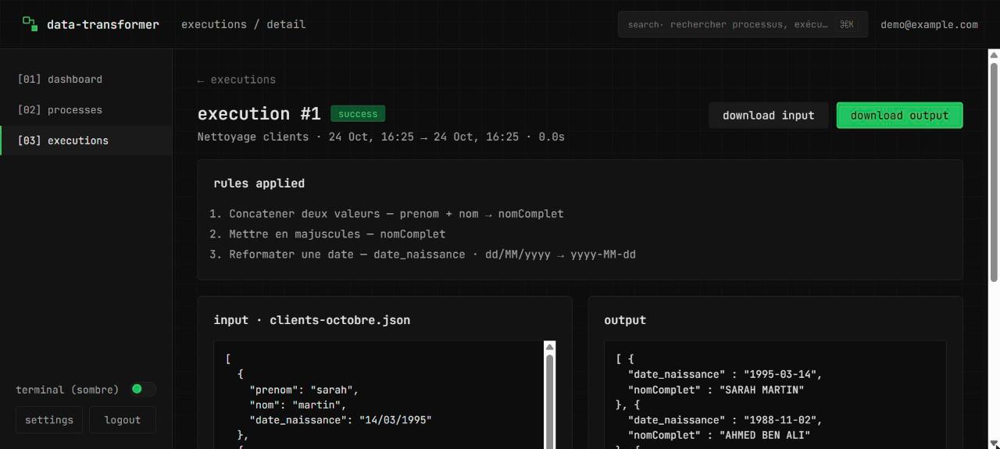
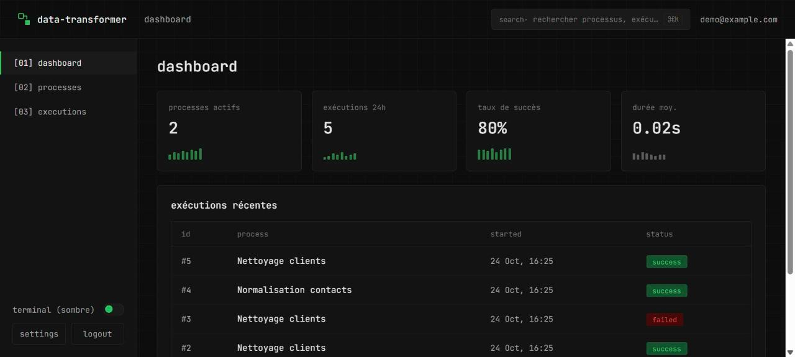
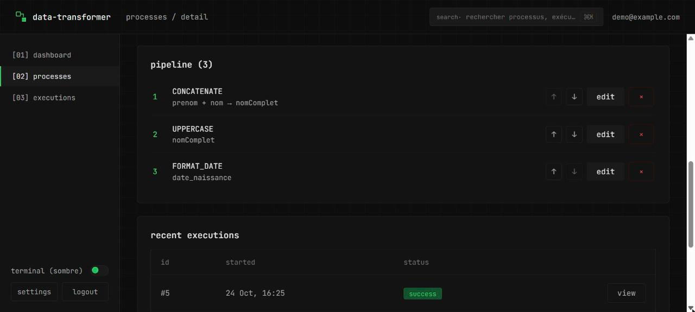
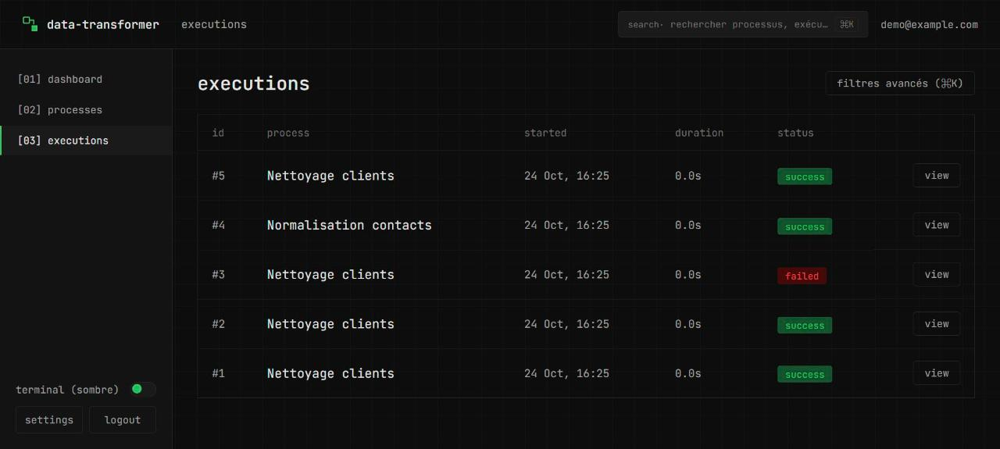
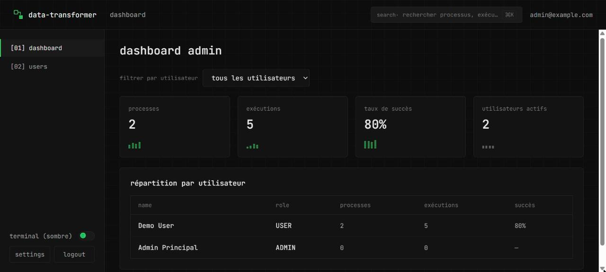

# Data Transformer

Application web **full-stack** de transformation de fichiers de données : l'utilisateur définit un *traitement* — une chaîne de règles (renommer un champ, concaténer, mettre en majuscules, reformater une date) — puis l'exécute sur des fichiers **JSON** ou **XML** et consulte l'historique de chaque exécution (fichier d'entrée, résultat, règles appliquées).

> Projet réalisé en binôme lors d'un stage d'été (août 2026), développé de zéro.

[](https://github.com/RadhwenT/Data-Transformer/actions/workflows/ci.yml)     

## Aperçu



| Tableau de bord | Pipeline de règles d'un traitement |
| --- | --- |
|  |  |
| **Historique des exécutions** | **Tableau de bord administrateur** |
|  |  |

## Points clés

- **Moteur de transformation** : règles enchaînées dans un ordre défini ; chaque exécution conserve le fichier d'entrée, le résultat et les règles appliquées (téléchargeables).
- **Deux rôles** : `USER` (traitements, exécutions, historique) et `ADMIN` (gestion des comptes, tableau de bord global).
- **Sécurité** : authentification par session, mots de passe hachés, chaque utilisateur n'accède qu'à ses propres traitements et exécutions.
- **Interface Angular** : thème clair / sombre, palette de commandes `Ctrl+K`.
- **152 tests automatisés** exécutés à chaque push : 116 côté backend (JUnit, dont des tests d'intégration sur un vrai PostgreSQL via Testcontainers) et 36 côté frontend (Vitest).

## Stack technique

| Couche | Technologies |
| --- | --- |
| Backend | Java 25, Spring Boot 4 (Web, Data JPA, Validation), Jackson (JSON / XML) |
| Frontend | Angular 22, TypeScript |
| Base de données | PostgreSQL 16 (Docker Compose) |
| Tests | JUnit 5, Mockito, Testcontainers, Vitest |
| CI | GitHub Actions |

## Lancer le projet

Prérequis : **JDK 25**, **Node.js 22+**, **Docker Desktop**. Maven n'est pas nécessaire (Maven Wrapper inclus).

```bash
# 1. Base de données
docker compose up -d

# 2. Backend (port 8081)
cd data-transformer
./mvnw spring-boot:run          # Windows : .\mvnw spring-boot:run

# 3. Frontend (port 4200), dans un autre terminal
cd data-transformer-frontend
npm install
npm start
```

Ouvrir **http://localhost:4200**. Des comptes et un traitement d'exemple (« Nettoyage clients ») sont créés au premier démarrage :

| Rôle | Email | Mot de passe |
| --- | --- | --- |
| Utilisateur | `demo@example.com` | `demo123` |
| Administrateur | `admin@example.com` | `admin123` |

Des fichiers d'exemple sont fournis à la racine : `simple.json`, `clients-multi.json`, `clients-erreur.json` (ce dernier produit volontairement une exécution en erreur).

## Tests

```bash
cd data-transformer && ./mvnw test                    # Docker doit être démarré
cd data-transformer-frontend && npx ng test --watch=false
```

## Documentation

- [Cahier des charges](docs/cahier-des-charges.md)
- [Modèle entité-association (MCD)](docs/modele-donnees.md)
- [Scénario nominal](docs/scenario-nominal.md)
- [Diagramme d'état_transition — Exécution](docs/etat_transition.md)
- [Diagramme de sequence — A](docs/sequence-scenario-a.md)
- [Diagramme de sequence — B](docs/sequence-scenario-b.md)
- [Diagramme de classes](docs/classes.md)
- [Liste des API REST](docs/api-list.md)

## Écrans (frontend)

Navigation en sidebar, dont le contenu dépend du rôle de l'utilisateur connecté (`role = USER` ou `ADMIN`).

**Rôle `USER`**
- `/login` — connexion
- `/dashboard` — vue d'ensemble personnelle (KPIs, exécutions récentes)
- `/processes` — liste des traitements (recherche, création, suppression, bouton use)
- `/processes/new`, `/processes/:id` — création/édition d'un traitement et de son pipeline de règles (brouillon local, sauvegardé en un clic via « save changes »), historique récent
- `/processes/:id/run` — dépôt de fichier, rappel des règles du pipeline, lancement d'une exécution
- `/executions`, `/executions/:id` — historique des exécutions (filtres via la palette de commandes ⌘K) et détail (input/output, règles appliquées, téléchargement de l'entrée et de la sortie)
- `/settings` — modification du profil (prénom/nom/email) et changement de mot de passe

**Rôle `ADMIN`** (ne voit ni `/dashboard`, ni `/processes*`, ni `/executions*`)
- `/admin/dashboard` — vue agrégée tous utilisateurs (KPIs, répartition par utilisateur, filtre par utilisateur)
- `/admin` — gestion des comptes utilisateurs (création, désactivation/réactivation)
- `/settings` — profil et mot de passe, comme pour un `USER`

> L'aperçu avant exécution (dry-run) reste disponible côté API (`POST /api/processes/{id}/preview`, voir `docs/api-list.md`) mais n'est plus exposé dans l'interface — l'écran `run` affiche directement le pipeline de règles en lecture seule à la place.

## Thème et palette de commandes

- **Thème clair/sombre** : bouton dans la sidebar (`ThemeService`), préférence mémorisée dans `localStorage`. Sombre par défaut.
- **Palette de commandes** (`⌘K` / `Ctrl+K`) : navigation rapide entre écrans et bascule de thème, accessible depuis n'importe quel écran connecté (`AppShell`).

> **Données décoratives** : les mini-graphiques (sparklines) des écrans `/dashboard` et `/admin/dashboard` sont des données **mockées en dur** dans le composant (`dashboard.ts`, `admin-dashboard.ts`) — aucun historique agrégé n'est calculé côté backend pour l'instant. Les KPIs chiffrés (nombre de traitements, taux de succès, durée moyenne) à côté sont en revanche calculés à partir des vraies données (`GET /api/processes`, `/api/executions`).