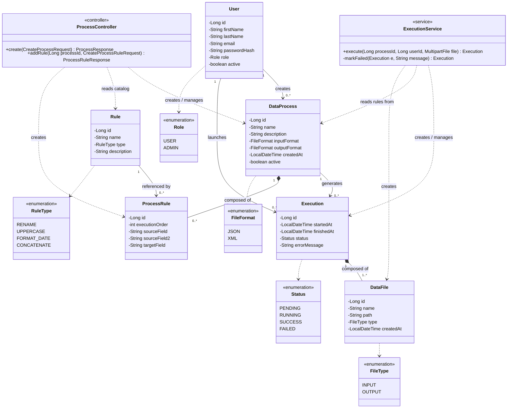

# Diagramme de classes UML

## Architecture en couches

Le diagramme suit l'architecture standard Spring Boot en 4 couches : **Controller → Service → Repository → Entity**, avec une exception assumée pour `DataProcess`/`ProcessRule`.

- Les **entités** (`User`, `DataProcess`, `Rule`, `ProcessRule`, `Execution`, `DataFile`) sont de pures structures de données — attributs privés, aucune méthode métier. Elles ne connaissent aucun concept lié au web (`MultipartFile`, requêtes HTTP...).
- **`ExecutionService`** porte toute la logique métier des exécutions : lecture du fichier, application des règles (déléguée à `RuleChainRunner`, partagé avec le dry-run de `PreviewService`), décision du statut final.
- **`DataProcess`/`ProcessRule` n'ont pas de service dédié** — `ProcessController` accède directement aux repositories (`DataProcessRepository`, `ProcessRuleRepository`) et porte lui-même les quelques vérifications nécessaires (unicité du nom par utilisateur, appartenance de la ressource). Décision assumée pour un CRUD simple sans logique métier complexe à isoler (voir `docs/api-list.md`, section « Correspondance avec l'architecture ») — pas un oubli.
- Les flèches en pointillés (`..>`) entre un contrôleur/service et une entité représentent une **dépendance d'usage** (il manipule l'entité sans la posséder), à distinguer des associations/compositions entre entités elles-mêmes.

Ce découpage évite le couplage entité ↔ couche web (`MultipartFile` ne vit que dans `ExecutionService`) et facilite les tests unitaires des services sans base de données réelle.

## Décisions de conception

| Relation | Type retenu | Justification |
|---|---|---|
| `DataProcess` ↔ `ProcessRule` | **Composition** (`*--`) | Une règle paramétrée n'a aucun sens hors de son traitement ; supprimée automatiquement avec lui (cascade + `orphanRemoval`). |
| `Execution` ↔ `DataFile` | **Composition** (`*--`) | Un fichier n'existe que rattaché à son exécution ; supprimé avec elle. |
| `Rule` ↔ `ProcessRule` | **Association simple** | Une règle du catalogue est réutilisable et existe indépendamment ; `ProcessRule` la référence sans la posséder. |
| `DataProcess` ↔ `Execution` | **Association simple + contrainte `RESTRICT`** | La suppression d'un traitement doit être bloquée tant qu'il a des exécutions liées, pour préserver l'historique (cohérent avec le cahier des charges : *« Base de données PostgreSQL pour l'historique des exécutions »*). Aucune suppression en cascade — comportement par défaut d'une clé étrangère PostgreSQL, sans code supplémentaire. En pratique, un traitement n'est jamais supprimé physiquement : `DELETE /api/processes/{id}` se contente de poser `active = false` (suppression logique), ce qui rend la question du `RESTRICT` largement théorique tant que rien ne purge la table. |

## Valeurs contrôlées (énumérations)

Chaque champ à choix limité est modélisé en énumération, jamais en `String` libre :

- **`Status`** — cycle de vie d'une exécution (voir le [diagramme d'état](etat_transition.md))
- **`FileType`** — distingue fichier d'entrée / de sortie
- **`FileFormat`** — format accepté par un traitement (`JSON` ou `XML`)
- **`RuleType`** — type de transformation dans le catalogue de règles. Les 4 valeurs sont illustrées dans le scénario nominal et les données de démonstration (`CONCATENATE`, `UPPERCASE`, `FORMAT_DATE`, `RENAME`).
- **`Role`** — distingue `USER` (crée/exécute ses propres traitements) et `ADMIN` (gère les comptes, vue agrégée tous utilisateurs) ; voir la note « rôles et suppression logique » dans le [MCD](modele-donnees.md).

## Correspondance avec le modèle de données

Les classes utilisent le nommage Java standard (singulier, PascalCase — `User`, `DataProcess`...), mappées vers les tables du [MCD](modele-donnees.md) (préfixe `DT_`, pluriel) via `@Entity` + `@Table(name = "DT_...")` en JPA. Les attributs sont privés (`-`), accessibles via des getters/setters publics générés par Lombok.

**Nommage** : les entités sont nommées `DataFile` et `DataProcess` (plutôt que `File`/`Process`) précisément pour éviter la collision avec `java.io.File` et `java.lang.Process` du JDK — décision prise avant l'écriture des classes, appliquée dans tout le code.
