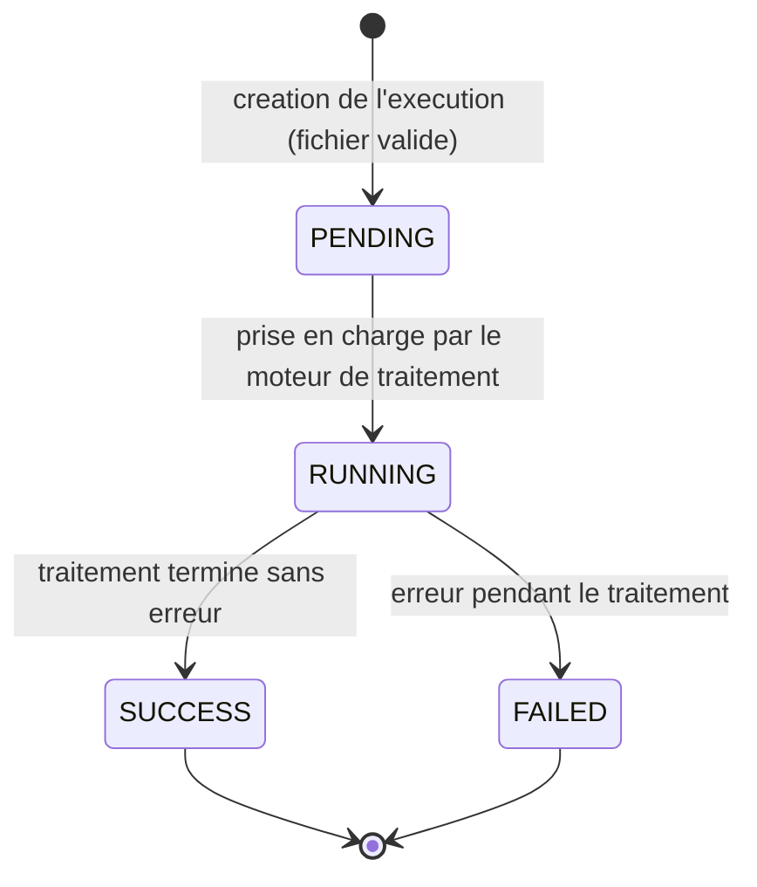

# Diagramme d'état-transition — Exécution

Cycle de vie du `status` d'une ligne `DT_executions`.

## États

- **PENDING** (« en attente ») — l'exécution est créée en base, le fichier d'entrée est validé, le traitement n'a pas encore démarré.
- **RUNNING** (« en cours ») — le moteur de traitement applique les règles configurées, dans l'ordre (`execution_order`).
- **SUCCESS** (« succès ») — traitement terminé, fichier de sortie généré et rattaché à l'exécution (`DT_files`, type `OUTPUT`).
- **FAILED** (« erreur ») — le traitement s'est interrompu ; `error_message` est renseigné.

Les deux derniers états sont finaux : une fois atteints, l'exécution n'évolue plus.

> **Note** : il n'existe pas d'état `CANCELLED`. L'annulation n'est possible que côté interface, avant l'envoi de la requête au serveur (aucun appel API, aucune ligne créée en base) — voir le [scénario nominal](scenario-nominal.md), Scénario B, étape 4.
