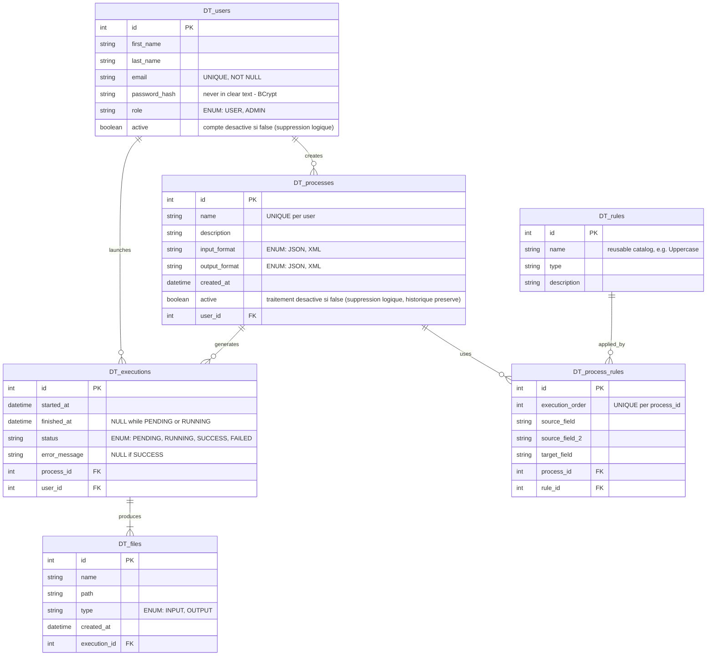

# Modèle entité-association (MCD)

## Note — rôles et suppression logique

`DT_users.role` distingue deux profils : `USER` (crée et exécute ses propres traitements) et `ADMIN` (gère les comptes et consulte une vue agrégée tous utilisateurs, mais n'a pas accès aux écrans de traitement/exécution). Un compte peut être désactivé (`active = false`) plutôt que supprimé, pour préserver l'historique des traitements et exécutions qu'il a créés — même logique de suppression logique appliquée à `DT_processes.active`.