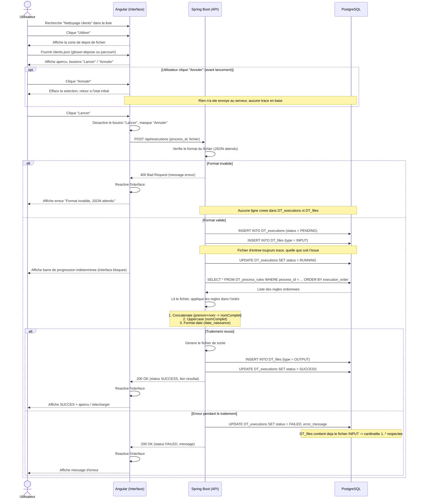

# Diagramme de séquence — Scénario B : Exécution d'un traitement existant

## Note sur la cardinalité `Execution` ↔ `File`

Le modèle de données impose qu'une exécution ait **au moins un fichier** (`1..*`). Pour que cette contrainte reste vraie dans tous les cas, le fichier d'entrée (`type = INPUT`) est systématiquement enregistré **dès que le format est validé**, avant même que le traitement ne démarre — indépendamment de l'issue finale (`SUCCESS` ou `FAILED`).

Le fichier de sortie (`type = OUTPUT`) n'est ajouté qu'en cas de succès.